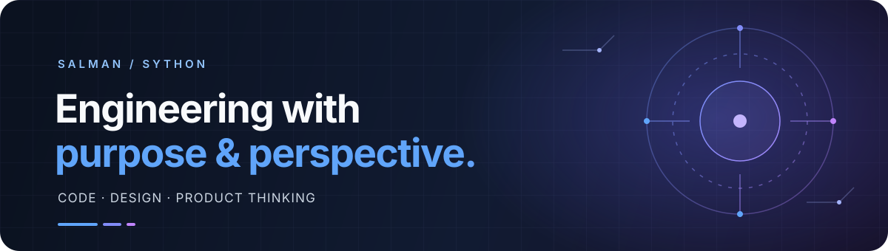

# Hi, I'm Salman (Sython) 👋

  
   
  <strong>Product-minded Frontend Developer · Design Lead</strong>
  
I build thoughtful digital products at the intersection of engineering, design, and product thinking.

  

    
    
    
  

---

## About

I'm a frontend developer who looks beyond the interface. I enjoy turning ambiguous ideas into clear product experiences, building maintainable React applications, and connecting design decisions with practical engineering trade-offs.

My work sits across three connected areas:

- **Engineering** — reusable frontend architecture, React applications, and reliable implementation.
- **Design** — UI systems, RTL experiences, interaction details, and design-to-code workflows.
- **Product** — understanding user needs, shaping scope, prioritizing outcomes, and making pragmatic trade-offs.

## Tech I work with

  

## Selected projects

<table>
  <tr>
    <td width="50%" valign="top">
      <h3><a href="https://github.com/slmn-pr/super-dot">Super Dot</a></h3>
      
A Next.js and React application for the DotOne product ecosystem, with separate app and landing-page route groups.

      Next.js · React · TypeScript · Tailwind CSS
    </td>
    <td width="50%" valign="top">
      <h3><a href="https://github.com/slmn-pr/crisis-council">Crisis Council 2050</a></h3>
      
A crisis-simulation web application with player journeys, role-based admin access, analytics, and a PostgreSQL-backed API.

      Node.js · Express · PostgreSQL · TypeScript · Docker
    </td>
  </tr>
  <tr>
    <td width="50%" valign="top">
      <h3><a href="https://github.com/slmn-pr/dotone-play">DotOne Play</a></h3>
      
A responsive Persian RTL gaming and rewards concept, built as a product demo with a modular interface and staged feature scope.

      Next.js · React · TypeScript · Tailwind CSS
    </td>
    <td width="50%" valign="top">
      <h3><a href="https://github.com/slmn-pr/gg10-front">GG10 Front</a></h3>
      
A React starter for a gaming-style dashboard, structured around reusable UI primitives, theming, routing, and RTL support.

      React · Vite · Material UI · TanStack Query
    </td>
  </tr>
</table>

## What I'm exploring

- Product Engineering and better product/engineering collaboration
- UX principles, design systems, and design thinking
- Three.js, WebGL, and interactive 3D experiences
- AI-assisted development and multi-agent workflows

## GitHub at a glance

  
  

---

  
<em>Good products happen when engineering, design, and user needs move in the same direction.</em>

  Thanks for stopping by · Feel free to explore my repositories

